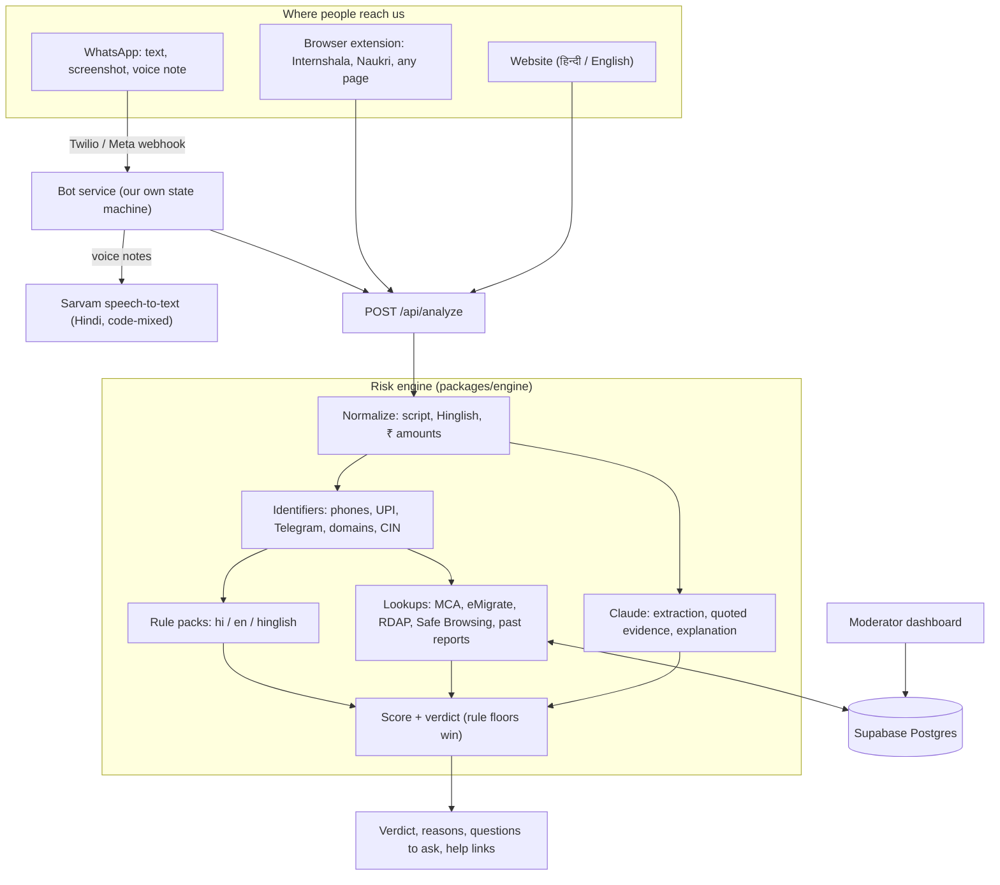

> **Status, 7 Nov 2026.** The project has moved from an India-first plan (below, kept for history) to a
> Global South focus on deceptive recruitment into troll farms / covert propaganda and scam-compound
> trafficking, plus job scams. Built so far, all working without API keys: website + risk-check chatbot,
> message scanner, WhatsApp tipline (Twilio + Meta webhooks + simulator), browser extension, the
> 4-class fine-tuned classifier, and a 19-country help directory. Working name is now **HireAware**. See
> `README.md` for the current architecture and `trial-modeling-news/README.md` for model results.

# JobJaanch: build plan

*Working name. Pick anything neutral (see §10). Drafted 2026-11-07.*

**Goal:** spot job posts and recruiter messages in India that recruit for paid trolling, scam compounds or job fraud, in Hindi, English and Hinglish. Also help people who are already inside these jobs get out safely.

**Assumptions** (change these first if they're wrong):
- Pilot country is India. Languages are Hindi (Devanagari), English, and romanized or code-mixed Hindi ("Hinglish").
- The hackathon runs 36–48 hours with about 4 people.
- We write our own bot and analysis pipeline, with no chatbot builders and no forked tiplines (§2).
- TypeScript for everything users touch. Python only for research.

---

## 1. What we're building

| Layer | Surface | What it does | In the MVP? |
|---|---|---|---|
| **1 · Detect** | WhatsApp bot | User forwards a recruiter's message, screenshot or voice note. The bot replies in the user's language with a risk verdict, reasons quoted from the message, questions to ask the recruiter, and where to get help | Yes |
| | Browser extension | Badge on Internshala and Naukri listings. Right-click any selected text (Facebook groups, Telegram Web, LinkedIn…) to check it | Yes: 2 sites + right-click |
| | Web checker | Paste text or upload a screenshot on the website | Yes |
| **2 · Prevent & exit** | Learn | Red flags per category with real (redacted) examples, in Hindi and English | Yes |
| | Evidence guide | What to keep and how to keep it safely | Guide yes. Local evidence-log tool later |
| | Help directory | Cyber-crime helpline, fraud reporting, recruiter checks, embassies, NGOs, mental health | Yes |
| | Anonymous report | Adds phone numbers, handles, UPI IDs and domains to a moderated database | Yes |
| **Research** | Pattern analysis | Builds a small corpus of Indian postings and finds the language these posts use. Feeds new rules and a public "patterns" page | Yes, small corpus |

## 2. Building it ourselves: what "no ready-made chatbots" means here

- **We write:** the conversation logic (a small state machine), message parsing, rule packs, scoring, and all Hindi and English copy.
- **We don't use:** chatbot builders or flow tools from WhatsApp providers, such as WATI, AiSensy, Interakt, Gupshup's bot studio, Twilio Studio, Botpress, Dialogflow, Voiceflow, or hosted "AI agent" platforms. We don't fork existing tiplines such as Cofacts or Meedan Check.
- **We use as raw parts:**
  - a messaging transport (WhatsApp via Twilio or Meta's Cloud API)
  - a speech-to-text API
  - the Claude API as one step inside our pipeline. It reads screenshots, pulls fields out of messy Hindi and Hinglish, and writes explanations.
- **Rules and lookups produce a verdict even with the LLM step switched off.** So the analysis belongs to us, and we can show judges a rules-only mode.

## 3. Architecture



**How a WhatsApp message flows:**
1. Webhook arrives. Check the signature and return 200 at once.
2. After responding, download any media into memory and transcribe voice notes with Sarvam.
3. Run `analyze()`.
4. Reply through the transport API and discard the media.

## 4. The risk engine (`packages/engine`): the core

### 4.1 Pipeline
1. **Normalize the text:**
   - Unicode NFC. Turn Devanagari digits (०–९) into 0–9.
   - Strip nukta (U+093C) and ZWJ/ZWNJ before matching (do the same to the patterns).
   - Parse amounts ("₹3k", "3 हज़ार", "Rs 3,000/day", "2 लाख", "$1200") into value, currency and period.
   - Detect language from the share of Devanagari characters plus a small Hinglish word list (hai, karo, kamao, ghar, paise, nahi…).
2. **Extract identifiers with regex, no AI:**
   - phones, parsed by `libphonenumber-js` to get the country
   - `wa.me` and `t.me` links, @handles
   - UPI IDs (`name@okaxis`, `@ybl`, `@paytm`…), emails, URLs and domains
   - CIN, GSTIN and recruiting-agent licence numbers
3. **Rule packs.** YAML per language (§4.3). Each rule has a weight, category, explanation (hi/en), sources and its own tests.
4. **Lookups** (§4.4).
5. **LLM step** (§4.5). Structured extraction, extra flags backed by verbatim quotes, and the explanation.
6. **Score and verdict** (§4.6).

### 4.2 India risk taxonomy (v0, which the research workstream will refine)

| Category | Typical bait | Strong signals | Example phrases |
|---|---|---|---|
| **Paid trolling / disinformation-for-hire** | "Social media executive", "digital campaign associate", "political campaign intern", "trend manager", "WhatsApp group admin" | Fake/dummy accounts or personas. Pay per post, comment, retweet or trend. "Old accounts with followers needed". Hashtag quotas. Secrecy about the client. Paid political posting that isn't disclosed | फ़र्ज़ी अकाउंट चलाने होंगे · हैशटैग ट्रेंड कराना · प्रति ट्वीट भुगतान · "dummy ID chalani hai" · "per tweet ₹2" |
| **Overseas scam-compound recruitment** (trafficking risk) | "Digital Sales & Marketing Executive", "Customer Support", data entry or "chat process" jobs in Thailand, Laos, Cambodia or Myanmar | Free ticket and visa. Tourist visa or visa-on-arrival. No eMigrate licence for the recruiting agent. Fee above ₹30,000 + GST. Interview only on WhatsApp/Telegram. High pay in USD for basic English and typing | विदेश में नौकरी · थाईलैंड में डेटा एंट्री · फ्री वीज़ा-टिकट · "Bangkok joining, visa free" |
| **Task / part-time scams** | "Work from home", "part-time job", "like/review tasks" | Daily earnings claims. Like, subscribe or review tasks. Telegram groups. "Prepaid/merchant tasks", VIP levels. USDT | घर बैठे कमाएँ · वीडियो लाइक करें · रोज़ाना ₹3000 · "task complete karo, commission milega" |
| **Fee & identity fraud** | Any role, often posing as a big brand | Registration, training or kit fee, or a "refundable deposit". Payment to a personal UPI ID. Aadhaar, PAN, bank details or OTP requested before any offer. A gmail "HR" for a big company. Lookalike domains | रजिस्ट्रेशन फीस · आधार-पैन भेजें · OTP बताएँ · "joining kit ke paise" |
| **Money mule / account renting** | "Payment processing agent", "finance assistant" | Receive payments and forward them. Rent out your bank account, UPI, SIM or WhatsApp. Commission per transaction | अपना बैंक खाता किराये पर दें · "UPI de do, commission milega" |

**Signals that lower risk:**
- the CIN is on MCA, active, and the company isn't brand-new
- the email domain matches the company
- the recruiting agent's licence is valid (overseas jobs)
- interviewers are named and there is a real interview
- a written offer shows the CIN and address
- no fees are asked

**The hard part from our notes is telling a real social-media job from a troll-farm job.** A legit job also "manages multiple accounts", for clients. So weak signals (multiple accounts, political content, night shifts) count only alongside a strong one: fake personas, pay per post, secrecy, or account renting. The legit half of the eval must include real PR, social-media and political-campaign jobs. That way we measure false positives on exactly the jobs most at risk of being wrongly flagged.

### 4.3 Rule pack format

```yaml
# packages/rules/in/fee_fraud.yaml
- id: IN.FEE.UPFRONT
  category: fee_fraud
  weight: 4
  floor: high                       # an upfront fee to get hired is always High
  match:
    en: ['\b(registration|joining|training|kit|processing)\s+(fee|fees|charges?)\b',
         '\brefundable\s+(security\s+)?deposit\b']
    hi: ['(रजिस्ट्रेशन|पंजीकरण|जॉइनिंग|ज्वाइनिंग|प्रशिक्षण|ट्रेनिंग)\s*(फीस|शुल्क|चार्ज)',
         'सिक्योरिटी\s*डिपॉजिट']
    hinglish: ['(registration|joining)\s*(fee|fees|charge)\s*(dena|deni|bharna|jama)']
  unless_near:                       # a negation within ±40 characters cancels the hit
    - '\b(no|zero|never|free of cost)\b'
    - 'कोई|नहीं|निःशुल्क|मुफ्त'
    - '\b(nahi|nahin|koi)\b'
  explain:
    en: "You're asked to pay before being hired. Genuine employers don't charge candidates."
    hi: "नौकरी मिलने से पहले पैसे माँगे जा रहे हैं। असली कंपनियाँ उम्मीदवारों से पैसे नहीं लेतीं।"
  sources: [mea-advisory-2024-05, i4c-advisories]
  tests:
    match:    ["Pay Rs 499 registration fee to confirm your slot",
               "₹999 रजिस्ट्रेशन शुल्क जमा करें",
               "joining kit ke liye 1500 registration fee bharna hoga"]
    no_match: ["No registration fee. We never charge candidates.",
               "कोई रजिस्ट्रेशन फीस नहीं है"]
```

- Rules live in the repo so a non-coder can add them through a pull request. Ideally a native Hindi speaker owns them.
- CI runs every rule's `tests`.
- Don't use `\b` in Devanagari patterns. JavaScript word boundaries only understand ASCII letters.

### 4.4 Lookups (India data sources)

| Check | How | Key | Notes |
|---|---|---|---|
| Is the company registered and active, and how old is it? | MCA company master data from data.gov.in (OGD "RoC-wise Company Master Data"), imported into Postgres and fuzzy-matched with `pg_trgm` | `DATA_GOV_IN_API_KEY` (free) | Brand names often differ from legal names, so "not found" means *couldn't verify*, never "fake". The free Supabase database holds 500 MB, so import only active companies and the columns we need. Check the resource ID in the data.gov.in catalog |
| CIN or GSTIN quoted in the ad | Offline format check. A CIN encodes listed/unlisted, industry (NIC code), state and year of incorporation. A GSTIN has a checksum | none | A CIN from 2025 on a firm claiming "10 years in business" is a flag. Link users to MCA's own lookup to confirm |
| Is the overseas recruiter licensed? | eMigrate "List of active RAs" plus MEA's list of unregistered agents, snapshotted weekly | none | Recruiting Indians for jobs abroad requires registration with the Protector General of Emigrants (Emigration Act 1983, s.10). Fees are capped at ₹30,000 + GST, and sub-agents aren't allowed |
| Where is this phone number from? | `libphonenumber-js` | none | Numbers from +66, +855, +856 or +95 recruiting for data entry or customer support are a flag |
| How old is the domain? | RDAP via `rdap.org` (WHOIS API as fallback) | none | Under 90 days old is a flag |
| Is the link malicious? | Google Safe Browsing Lookup API | `GOOGLE_SAFE_BROWSING_API_KEY` | Free for non-commercial use |
| Have we seen this before? | Our database: phones, Telegram handles, UPI IDs, domains, plus near-duplicate text via `pg_trgm` similarity | none | Only moderator-approved reports count |
| Reputation (stretch) | Claude's web search tool limited to allow-listed news, fact-check and government domains | none extra (billed per search) | Show the sources. Never auto-label a company |

### 4.5 LLM step (Claude API)

**What it does:**
- reads screenshots
- extracts fields from messy Hindi and Hinglish
- catches paraphrased signals the regex misses, each with a verbatim quote
- writes the explanation and the questions in the user's language

**Model and settings:**
- Use `claude-opus-5-5` (current Opus: $4 / $20 per million input / output tokens, cache reads $0.20).
- Start at `output_config: { effort: "low" }`, since this is classification work. Raise it only if the eval improves.
- Thinking is always on for this model. Don't send `thinking: {type: "disabled"}`, `temperature`, or an assistant prefill: the API rejects all three.

**Structured output:**
- Use `output_config.format` (`messages.parse()` in the SDK) with the Zod schema in `packages/shared`.
- Forced tool calls aren't available on this model.

**Prompt caching:** the system prompt (taxonomy, rule summaries, Hindi and Hinglish examples) goes first with `cache_control`. The forwarded content goes last.

**Treat forwarded text as untrusted:**
- Wrap it in `<forwarded_message>` tags. The system prompt says it is data, never instructions.
- Code makes sure LLM output can't lower a rule floor.
- **Evidence check:** drop any flag whose `evidence` quote isn't in the input, or in the model's own `ocr_text` for screenshots.

**Failures:**
- Check `stop_reason` for `"refusal"`.
- Turn on server-side fallbacks: `fallbacks: "default"` with the beta header `server-side-fallback-2026-07-01`.
- On a refusal, timeout or outage, return the rules-only result.

**Other uses and limits:**
- Corpus backfills run through the Message Batches API, which costs 50% less.
- Claude takes text and images, not audio. Voice notes go through Sarvam first.

**Cost:**
- About 4k cached system tokens + 1k input + 1k output comes to roughly **$0.02–0.04 per check**. $25–50 of credit covers the hackathon.
- Hindi text uses more tokens than English, so measure with token counting.
- If extension auto-scans push volume up, you could test `claude-haiku-5-5` ($0.10 / $0.50) for a pre-screen. That's your call; measure it on the eval first.

**Output schema** (one Zod schema in `packages/shared`, shown here as JSON):

```json
{
  "language": "hi | en | hinglish | mixed",
  "ocr_text": "text read from a screenshot, if any",
  "extracted": {
    "role_title": "Social Media Executive",
    "company_name": "…",
    "work_location": "Bangkok, Thailand",
    "pay": { "amount": 1200, "currency": "USD", "period": "month" },
    "fees_requested": [{ "label": "registration fee", "amount": 499, "currency": "INR" }],
    "asks_for": ["aadhaar", "pan", "bank_account", "otp", "passport"],
    "contact_channels": ["whatsapp", "telegram"],
    "visa_type": "tourist | visa_on_arrival | work | unknown"
  },
  "flags": [
    { "signal": "FAKE_PERSONAS", "category": "disinfo_for_hire",
      "evidence": "5 dummy ID chalani hongi", "strength": "strong" }
  ],
  "missing_info": ["company registration", "written contract"],
  "questions_to_ask": ["…"],
  "explanation": "2–4 sentences in the user's language"
}
```

### 4.6 Scoring and verdict

All numbers below are starting points to tune on the eval.

**How points add up:**
- Each rule hit adds its weight (1–5), and each rule counts once.
- Weak rules (weight 1) count only when a strong rule (weight 3 or more) also fired.
- Each LLM flag whose quote checks out adds 1 (weak) or 3 (strong), up to +6 in total.

**Lookup adjustments:**

| Finding | Points |
|---|---|
| Domain under 90 days old | +2 |
| MCA match that is active and over 3 years old | −2 |
| Company not found ("couldn't verify") | +1 |
| Valid recruiting-agent licence | −3 |
| Overseas job with no recruiting-agent licence | +3 |
| Each approved past report on an identifier | +2 (up to +6) |

**Hard floors.** Any of these makes the verdict at least `high`:
- a fee paid to a personal UPI ID
- renting out a bank account, UPI ID or SIM
- a requirement to run fake personas
- an overseas job in Southeast Asia combined with a tourist visa or no recruiting-agent licence
- a Safe Browsing hit

**LLM flags can raise the score but never lower a floor.** This guards against prompt injection.

**Verdicts:**
- `low` (0–3)
- `caution` (4–7)
- `high` (8 or more)
- `unclear`, when fewer than 2 facts were extracted. The bot then asks 2–3 follow-up questions instead of guessing.

Every verdict carries reasons with quotes, questions to ask the recruiter, and next steps.

### 4.7 What a WhatsApp reply looks like

```text
⚠️ जोखिम: ज़्यादा (High)

हमें ये संकेत मिले:
1. ₹499 "रजिस्ट्रेशन फीस" माँगी गई है — असली कंपनियाँ नौकरी देने के लिए पैसे नहीं लेतीं।
2. काम "वीडियो लाइक करने" का है और रोज़ ₹3,000 का वादा है — यह टास्क स्कैम का आम तरीका है।
3. संपर्क सिर्फ़ टेलीग्राम पर है, कंपनी का कोई रजिस्टर्ड नाम नहीं मिला।

भर्ती करने वाले से पूछें:
• कंपनी का पूरा रजिस्टर्ड नाम और CIN नंबर क्या है?
• क्या ऑफ़र लेटर ईमेल पर कंपनी के डोमेन से मिलेगा?

अगर पैसे दे चुके हैं: तुरंत 1930 पर कॉल करें या cybercrime.gov.in पर शिकायत करें।

जवाब दें: 1 और जाँच · 2 मदद · 3 रिपोर्ट · 4 मेरा डेटा मिटाएँ
```

The same reply goes out in English or Hinglish when the user writes that way.

## 5. Channels

### 5.1 WhatsApp bot (`apps/web/app/api/whatsapp`, `packages/channels`)

**Transport:**
- Hackathon: Twilio WhatsApp Sandbox. Judges join by texting `join <code>` and must rejoin after 3 days.
- Production: Meta's WhatsApp Cloud API. It needs Meta Business verification, and its test number reaches only 5 verified numbers.
- Both sit behind one `Channel` interface, so switching is a config change.

**State machine per user:**
- The key is an HMAC of the phone number.
- Steps: `NEW → consent → READY → ANALYZING → RESULT`, then `FOLLOW-UP`, `REPORT` or `HELP`.
- Commands work as numbers or words in Hindi, English or Hinglish: `1 जाँच/check`, `2 मदद/help`, `3 रिपोर्ट/report`, `4 मिटाएँ/delete`, `भाषा/language`.

**Inputs:**

| Input | How we handle it |
|---|---|
| Text, including forwarded text | Straight to `analyze()` |
| Screenshot | Claude vision |
| Voice note (OGG/Opus) | Sarvam. Its REST endpoint takes clips up to 30 s; longer clips go to Sarvam batch or get split |
| Link | Safe Browsing and RDAP only. Don't fetch arbitrary URLs from the server in the MVP (SSRF risk) |

**Behaviour:**
- **Reply fast:** return 200 at once, do the work in Next.js `after()`, then reply through the REST API.
- **Stay on topic:** off-topic messages get "यह सेवा सिर्फ़ नौकरी के ऑफ़र जाँचती है" plus the menu. Being a single-purpose service matters under Meta's 2026 terms (§10).
- **First message safety copy:** neutral bot name and picture. Suggest turning on disappearing messages or deleting the chat if someone else checks the phone.
- **Rate limit** per phone hash, for example 20 checks per hour, stored in Postgres.
- **Later:** a Telegram adapter behind the same interface. Many task-scam groups live there.

### 5.2 Browser extension (`apps/extension`, WXT + React, Manifest V3)

**Where it runs:**
- **MVP site adapters:** Internshala and Naukri. The extension reads the listing on screen, shows a badge, and opens a side panel with the result.
- **Later:** Indeed India, Apna, foundit, Shine, and LinkedIn Jobs (opt-in). LinkedIn's user agreement restricts scraping add-ons, so only read the page in view, and only when the user acts.
- **Everywhere else:** right-click selected text and choose "Check this job offer". This covers Facebook groups, Telegram Web, Instagram and WhatsApp Web.

**Privacy:**
- **No secrets in the extension, since anyone can unpack it.** It only calls our `/api/analyze`.
- Send only the listing text and URL, never browsing history. Cache results by URL hash.

**Other:**
- UI in Hindi and English (`_locales/hi`, `_locales/en`).
- **Stretch:** an on-device pre-screen (rules plus a small character-n-gram model) so auto-scan never leaves the browser. The deep check runs only on click.

### 5.3 Website (`apps/web`, Next.js + next-intl, hi/en)

**Pages:**

| Page | Purpose |
|---|---|
| `/check` | Paste text or upload a screenshot |
| `/learn` | Red flags per category with examples |
| `/patterns` | Findings from the research corpus |
| `/evidence` | What to keep and how to keep it safely |
| `/help` | Help directory |
| `/report` | Anonymous report |
| `/about` | Methodology, neutrality and privacy |
| `/admin` | Moderators only |

**Evidence guide content (India):**
- screenshots that show the number or handle and the date
- the ad's URL plus an archived copy
- offer letters
- payment receipts with the **UTR/transaction ID** (a 1930 complaint needs it)
- a WhatsApp "Export chat"
- for overseas jobs: passport, visa and ticket copies
- keep copies with a trusted person
- report any money lost to 1930 quickly. The sooner you report, the better the chance the money can be frozen.

**Help directory seed list** (verify every entry before launch):
- 1930 and cybercrime.gov.in
- Sanchar Saathi → Chakshu, to report fraud calls, SMS and WhatsApp messages
- eMigrate, to check a recruiting agent, and the PBSK toll-free line 1800-11-3090
- the MADAD portal and the Indian embassies in Bangkok, Phnom Penh, Vientiane and Yangon
- Childline 1098
- Tele-MANAS 14416 for mental health
- anti-trafficking NGOs and digital-rights legal help. Confirm they take these cases.
- platform reporting forms for coordinated fake accounts

**Design:**
- Mobile-first, light pages, Noto Sans Devanagari. Hindi by default for browsers set to `hi`.
- A quick-exit button. No third-party analytics or tracking cookies.
- **Stretch:** read results aloud in Hindi (Sarvam text-to-speech) for users who struggle with reading.

## 6. Research and data workstream (the "specific analysis")

1. **Collect automatically.** A Claude-run collector (§6.2) gathers examples in Hindi, English and Hinglish from sources whose terms and robots.txt allow it (§6.1). That includes hard negatives: real PR, social-media and political-campaign jobs.
2. **Redact.** The collector removes private people's names, numbers and faces during extraction. A person spot-checks before anything is committed. Raw files stay out of git.
3. **Label.** Rules and Claude label everything with the §4.2 taxonomy. Following `docs/labeling-guide.md`, a person reviews every disagreement, the whole eval set (about 380 examples) and a random sample of training labels.
4. **Analyse** what distinguishes each category, per language, with a log-odds ratio and a Dirichlet prior ("Fightin' Words", Monroe et al. 2008). Also look at pay structures, channels, destinations and bait titles. The results become new rules and the `/patterns` page.
5. **Evaluate** with `research/eval/run_eval`. Report:
   - precision and recall per category
   - **the false-positive rate on legit PR, social-media and political jobs** (the headline number)
   - a per-language breakdown

   Re-run after every change to a rule or prompt (in CI, as a stretch). Suggested targets: precision on `high` of at least 0.9, and false positives on legit PR jobs of at most 5%.
6. **Synthetic examples go in the training split only.** Mark them `synthetic: true`. The eval set holds real examples only.

### 6.1 Where the training data comes from

No public dataset of troll-farm or "misinformation job" ads exists (checked November 2026). We build ours in four layers.

**Layer 1: real examples, collected by Claude from sources that allow it**

Claude can do the collecting (§6.2), but only from sources whose terms and robots.txt allow automated access. The job boards themselves mostly don't.

| Source | Automate? | Why / how |
|---|---|---|
| Government advisories and alerts: MEA and embassy sites, PIB, cybercrime.gov.in, police and CBI press releases | Yes | Public notices. Claude's web search and web fetch, limited to allow-listed domains. PDFs work |
| Fact-checkers and news in Hindi and English (e.g. BOOM, Vishvas News, Newschecker, BBC Hindi) | Yes, where robots.txt allows | Keep only the quoted ad or message text, plus the link |
| Research datasets: Web Data Commons JobPosting extracts, Zenodo, Hugging Face, Kaggle | Yes | File downloads, so no live scraping of job boards |
| Internshala, Naukri, LinkedIn job pages | **No** | Internshala's robots.txt bars crawlers from job pages and blocks ClaudeBot. Naukri's server refused an automated fetch of its robots.txt (403). LinkedIn's terms ban scraping. Get these postings through the extension (the page a user is viewing, if they choose to share it) or a data partnership |
| Meta Ad Library | No; manual spot checks only | The API covers political and EU ads, and scraping the website breaks Meta's terms |
| Reddit | No | Its Data API terms bar training models on user content without permission, and legacy API access is being phased out |
| Telegram public channels | Later, after an ethics check | Official API, read-only, public channels only. Most task-scam ads live there |
| Private WhatsApp or Telegram groups | No | Joining groups to harvest people's messages isn't consented |

**What the collector looks for, per category**

| Category | Where it looks |
|---|---|
| Paid trolling / disinformation-for-hire | **Takedown coverage:** Facebook's April 2019 removal of 687 pages and accounts linked to the Congress IT cell and 15 linked to the IT firm Silver Touch; Meta's 2024 report on an Israeli firm's content about India's election. **Investigations** into paid "IT cell" and "social media volunteer" work that quote the offers or instructions. **"Trend alert" messages** from Jakesch et al. (2021): 75 campaigns with pre-written tweets, found in 600 pro-BJP WhatsApp groups. Ask the authors for the data. **Crawl data:** PR, social-media and political-campaign postings, mostly legit hard negatives, plus the rare one asking for dummy IDs or pay per post. Expect this category to stay small: tens of examples, not hundreds |
| Overseas scam-compound recruitment | MEA and embassy advisories (bait job titles, the route via Thailand). CBI and police press releases on trafficking rings. News reports that quote the offers |
| Task scams | I4C and police cyber-cell advisories. Fact-checkers' scam columns (e.g. Newschecker's Scam Watch). The team's own spam, forwarded to our bot |
| Fee & identity fraud | PIB Fact Check alerts on fake government-job notices (often in Hindi). Police advisories |
| Money mules | Police, RBI and bank advisories. News reports on mule-account busts |
| Legit (negatives) | Crawl-data postings for India, including employers' own career pages. Overseas jobs from agents on eMigrate's active list |

**Keep political examples balanced across parties.** Trend Alert covers one party's groups. If most troll examples come from one side, the model learns "party X means troll" instead of "fake accounts plus pay per post means troll".

**Research on troll farms elsewhere informs the taxonomy, not the training data:**
- Russia's Internet Research Agency mostly recruited young, inexperienced university students, also under ad, IT and PR job titles.
- Former workers at Arab troll farms describe no legal contracts and closely surveilled work.

**Layer 2: datasets to borrow from**

| Dataset | What's in it | Use it for |
|---|---|---|
| EMSCAD (Kaggle "Real or Fake Job Posting Prediction") | 17,880 English job ads, under 5% fraudulent, mostly from the US | Generic fraud cues such as fees and missing company details. Not India, not trolling |
| "The Traffickers' Pitch" (arXiv 2605.25416, 2026) | 85,841 job ads in English, Chinese and Russian. "Risky" is labeled when a phone number is reused across labor and sex-work boards | Its labeling idea: a listing that shares an identifier with a confirmed scam is probably risky. The authors say data and models are open; confirm before relying on it |
| SpamShield (Hugging Face `M-Arjun/SpamShield-Datasets`, CC BY 4.0) | 149k messages in 23 languages including Hinglish, with a `job_scam` label. Merged public sets plus about 20% augmentation | Hinglish scam phrasing. Count the Hinglish `job_scam` rows first |
| Hindi spam SMS (IEEE DataPort, NIT Silchar) | 3,894 Hindi SMS labeled spam or ham | Devanagari scam phrasing |
| Hostility Detection Dataset in Hindi (CONSTRAINT 2021, on CodaLab) | 8,200+ Hindi posts labeled fake, hate, offensive, defamation or non-hostile | A second-stage check on content a recruiter asks someone to post |
| Claim Detection and Matching for Indian Languages (Zenodo, DOI 10.5281/zenodo.4890949), plus Meedan's "Indian XLM-R" model | 5,066 WhatsApp tipline and public-group messages in English, Hindi, Bengali, Malayalam and Tamil, plus 2,343 message-to-fact-check pairs | Matching the same template across Hindi and English |
| Lexical mutants (Phadke & Mitra, ICWSM 2024) | 3.8k amplification campaigns on Twitter and Facebook groups (Farm Bills, CAA). About a third of campaign messages are reworded variants | The copy-paste-with-edits pattern that troll work produces, and their embedding-similarity method for clustering it |

The small Hinglish scam sets on Hugging Face (`bolewara/hinglish-scam-text-dataset`, `ysangam/Indian_Cyber_Scam_PhoneCall_Hinglish_Dataset`) are mostly hand-written examples or call transcripts. They're useful for phrasing ideas but too small or off-topic to train on.

**Layer 3: volume from crawl data and Claude labels**
- **Pool:** Web Data Commons publishes the schema.org `JobPosting` records found in Common Crawl. The most recent release we found was built from the October 2024 crawl. Filtering it to India gives thousands of real postings without touching any job board. Sites that block Common Crawl's crawler, like Internshala, won't be in it.
- **Labels:** Claude labels the pool through the Message Batches API (half price), and the rule packs vote as labeling functions. Where they agree, the label is provisional. Where they disagree, a person decides.
- **Identifier reuse:** a posting that shares a phone number, UPI ID or Telegram handle with a confirmed scam also gets a provisional risky label.
- A person checks a random sample of every provisional label before we train on it.

**Layer 4: augmentation for Hindi and Hinglish (training split only)**
- Translate English examples into Hindi. Transliterate between Devanagari and romanized Hindi (IndicXlit). Have Claude paraphrase with code-mixing.
- **Minimal pairs for the hardest boundary:** rewrite each troll-job example into a legit twin, e.g. "manage our client's 3 brand pages" vs. "run 20 dummy IDs at ₹2 per tweet". Pairs like these teach the difference better than more random examples.
- Mark everything `synthetic: true` and keep it out of the eval.

**Eval set targets (real examples, all checked by a person).** Training data is everything else the collector labels, plus synthetic examples.

| Category | Count |
|---|---|
| Paid trolling | 40–60 |
| Overseas recruitment | 40 |
| Task scams | 60 |
| Fee & identity fraud | 40 |
| Money mules | 30 |
| Legit, at least 60 of them PR, social-media or political-campaign jobs | 150 |
| **Total** | **about 380** |

**Collection rules**
- The collector only touches domains listed in `research/collect/sources.yaml`. Each entry records when someone checked that site's terms and robots.txt. Claude's web fetch also refuses pages that robots.txt blocks.
- At most one request every few seconds per domain. Our own fetcher (stage 3 in §6.2) identifies itself with a contact email.
- Keep the extracted ad or message text with its link and citation, not copies of articles or screenshots.
- Claude redacts private people's names, numbers and faces during extraction, and a person spot-checks. Raw files live in the private data repo.
- Scammers' public contact details (phones, handles, UPI IDs) go in a private table for identifier matching and are never published.
  - DPDP s.3(c)(ii) excludes data that people made public themselves, which probably covers recruiters' own public posts.
  - Its scope is contested, so record why each source qualifies.
- Label review happens in Label Studio or Argilla. Both are open source and handle Devanagari.

### 6.2 The collector (`research/collect/`)

A script that calls the Claude API; no one needs to sit in a chat. Every stage writes to Postgres with provenance: `source_url`, `fetched_at`, `stage`, `model`, `prompt_version`.

| Stage | What happens | Claude feature |
|---|---|---|
| 1. Discover | A query bank per category in Hindi, English and Hinglish ("नौकरी के नाम पर ठगी", "fake job offer Cambodia Indians rescued", "dummy accounts social media job") turns into candidate URLs | `web_search`, with `allowed_domains` taken from the registry |
| 2. Fetch and extract | For each page: the verbatim ad or recruiter text it quotes, with language, category guess, date and a redaction pass | `web_fetch_20260318` with citations on, plus structured output. Keep an example only if its text appears in a citation's `cited_text`. That proves it's verbatim, not invented |
| 3. Screenshots (optional) | Our own fetcher downloads images from allowed pages after a robots.txt check, and Claude reads them | Vision |
| 4. Bulk pool | Web Data Commons `JobPosting` files, filtered to India | None (download) |
| 5. Label | Rules and Claude label every example and posting. Disagreements go to a person | Message Batches API (half price), structured output |
| 6. Dedupe | The same ad quoted by ten outlets becomes one example | `pg_trgm` or embeddings |

**Cost on `claude-opus-5-5`** (Anthropic's price list):
- Web search: $10 per 1,000 searches, plus tokens for the results.
- Web fetch: only the tokens it reads, about 2,500 for an average page.
- A run of about 150 searches, 1,000 fetched pages and 10,000 labeled postings comes to roughly **$50–100** with the Batch API.
- Testing `claude-haiku-5-5` for the bulk labeling would bring that to a few dollars. That's your call; compare its labels with the human-checked sample first.

**Limits to plan around:**
- Web fetch only opens URLs that already appeared in the conversation (search results or our own message).
- It doesn't render JavaScript, and it returns text, not images (hence stage 3).
- An eval labeled by Claude can't fairly grade a model trained on Claude's labels. That's why a person checks the eval set.

**After the hackathon:** run the collector as a Claude Managed Agents scheduled deployment, so it refreshes weekly without a server of our own.

## 7. Data model (Supabase Postgres)

```text
listings             id, source(whatsapp|extension|web|research), url, url_hash, text_redacted, lang,
                     extracted jsonb, flags jsonb, verdict, score, rules_version, model, created_at
                     -- only for public postings, or when a user taps "report"
identifiers          id, kind(phone|telegram|upi|email|domain|company|cin|ra_licence), value_norm,
                     first_seen, last_seen, approved_reports
listing_identifiers  listing_id → listings, identifier_id → identifiers
reports              id, listing_id, channel, note_redacted, reporter_hash,
                     status(pending|approved|rejected), reviewed_by, reviewed_at
mca_companies        cin pk, name, name_norm (GIN trigram index), status, incorporated_on, state, activity
ra_registry          licence_no pk, name, status, valid_until, state, fetched_at
unregistered_agents  name, place, notice_url, notice_date
resources            id, name, kind(hotline|portal|embassy|ngo|legal|mental_health), states[], languages[],
                     phone, url, hours, verified_on
sources              id, title, publisher, url, published_on   -- citations behind rules and resources
wa_sessions          phone_hmac pk, lang, state, context jsonb, consent_at, expires_at  -- 7-day expiry
```

Row-level security: anonymous users can read `resources` only. Everything else goes through server routes that use the secret key.

**Stretch: network view.** Draw `identifiers` and `listings` as a graph to show clusters, for example "this Telegram handle appears in 9 reports under 4 company names". This is the "track sources of harmful listings" idea from our notes.

## 8. API keys and accounts

Every variable below is also in [`.env.example`](.env.example).

### For the hackathon MVP

| # | Service | Used for | Env vars | Cost | Where to get it |
|---|---|---|---|---|---|
| 1 | **Anthropic (Claude API)** | Reading screenshots, extraction, explanations | `ANTHROPIC_API_KEY` | Pay as you go, about $0.02–0.04 per check | console.anthropic.com → API keys. Set a spend limit |
| 2 | **Supabase** | Postgres with `pg_trgm`, moderator login | `NEXT_PUBLIC_SUPABASE_URL`, `NEXT_PUBLIC_SUPABASE_PUBLISHABLE_KEY`, `SUPABASE_SECRET_KEY` | Free tier (500 MB) | supabase.com → New project → Settings → API |
| 3 | **Twilio WhatsApp Sandbox** | WhatsApp transport for the demo | `TWILIO_ACCOUNT_SID`, `TWILIO_AUTH_TOKEN`, `TWILIO_WHATSAPP_FROM` | Trial credit | console.twilio.com → Messaging → Try it out → Send a WhatsApp message |
| 4 | **Sarvam AI** | Speech-to-text for Hindi and code-mixed voice notes | `SARVAM_API_KEY` | See their pricing page | dashboard.sarvam.ai |
| 5 | **Google Safe Browsing** | Flag malicious links | `GOOGLE_SAFE_BROWSING_API_KEY` | Free for non-commercial use | Google Cloud console → enable "Safe Browsing API" → Credentials → API key (restrict it) |
| 6 | **data.gov.in** | Download MCA company master data | `DATA_GOV_IN_API_KEY` | Free | data.gov.in → sign up → profile → API key |
| 7 | **Vercel** | Hosting the website, API and webhook | none, via the GitHub integration | Free Hobby plan | vercel.com → import the GitHub repo |
| 8 | **GitHub** | Org, repo, Actions | Actions secrets | Free | (§9) |
| 9 | **Tunnel (dev only)** | Exposes localhost to webhooks | `NGROK_AUTHTOKEN`, or nothing with `cloudflared tunnel --url` | Free | ngrok.com |
| 10 | **Kaggle (research only)** | Downloading the EMSCAD job-fraud dataset | `KAGGLE_USERNAME`, `KAGGLE_KEY` | Free | kaggle.com → Settings → API → Create New Token |
| — | **Generated by us** | HMAC key for phone numbers, moderator allowlist | `PHONE_HASH_SECRET`, `ADMIN_EMAILS` | — | `openssl rand -hex 32` |

**Needs no key:** language detection (`franc`), phone parsing (`libphonenumber-js`), RDAP, `pg_trgm`, CIN/GSTIN checks, the eMigrate snapshot.

### Later (after the hackathon, or stretch goals)

| Service | Why | Env vars | Notes |
|---|---|---|---|
| Meta WhatsApp Cloud API | A production WhatsApp number | `WHATSAPP_ACCESS_TOKEN`, `WHATSAPP_PHONE_NUMBER_ID`, `WHATSAPP_BUSINESS_ACCOUNT_ID`, `WHATSAPP_VERIFY_TOKEN`, `META_APP_SECRET` | Needs Meta Business verification; an NGO partner's legal entity can work. Replies inside the 24-hour window after a user's message have been free, but check current pricing |
| Telegram Bot API | A second channel | `TELEGRAM_BOT_TOKEN`, `TELEGRAM_WEBHOOK_SECRET` | Free, from @BotFather |
| Telegram API (research) | Reading public task-scam channels, only after an ethics check | `TELEGRAM_API_ID`, `TELEGRAM_API_HASH` | my.telegram.org. Read-only, public channels only |
| Internet Archive (Save Page Now) | One-tap "archive this ad as evidence" | `IA_ACCESS_KEY`, `IA_SECRET_KEY` | Free account |
| WhoisXML API | Domain age where RDAP has no data | `WHOISXML_API_KEY` | Free tier |
| Voyage AI | Near-duplicate search across Hindi and English (pgvector) | `VOYAGE_API_KEY` | Only if `pg_trgm` misses Hindi↔English duplicates |
| Sentry | Error monitoring | `SENTRY_DSN` | Strip message text from events |
| Chrome Web Store API | Publishing the extension from CI | `CHROME_EXTENSION_ID`, `CHROME_CLIENT_ID`, `CHROME_CLIENT_SECRET`, `CHROME_REFRESH_TOKEN` | $5 one-time developer fee. The Firefox and Edge stores are free |

## 9. GitHub

### 9.1 Org and repos

**One public monorepo, `jobjaanch`:**
- Create a free GitHub org named after the project and add every teammate.
- Most hackathons require a public repo. One repo also keeps the extension, bot and website on a single engine.
- License: MIT or Apache-2.0 for code, CC BY 4.0 for the learn and help content so NGOs can reuse it.

**Later, a private repo, `jobjaanch-data`:**
- Holds moderation exports, the raw corpus, and any non-public blocklists.
- Publishing every detection rule helps scammers adapt.

**Repo settings:**
- Protect `main`: require a pull request, 1 review and green CI.
- Install the Vercel GitHub app for a preview deploy on every pull request.
- Add an issue template called "Propose a red-flag rule" so non-coders can contribute patterns.
- Use a GitHub Project board laid out by the workstreams in §11.

### 9.2 Monorepo layout (pnpm workspaces + Turborepo)

```text
jobjaanch/
├── apps/
│   ├── web/            # Next.js: website (hi/en), /api/analyze, /api/whatsapp webhook, /admin
│   └── extension/      # WXT + React: Chrome / Edge / Firefox, Manifest V3
├── packages/
│   ├── engine/         # normalize → identifiers → rules → lookups → LLM → score (pure TS + Vitest)
│   ├── rules/          # YAML rule packs: in/hi, in/en, in/hinglish, each rule with its own tests
│   ├── channels/       # Twilio + Meta WhatsApp and Telegram adapters behind one Channel interface
│   └── shared/         # Zod schemas (the API contract), types, hi/en strings
├── research/           # Python: corpus tools, notebooks, pattern analysis, classifier experiments
│   ├── collect/        # Claude-run collector: sources.yaml allowlist, discover → extract → label
│   └── eval/           # human-checked, redacted JSONL + run_eval
├── scripts/            # import_mca.py, snapshot_emigrate.py
├── supabase/           # migrations/, seed.sql (help directory, sources)
├── docs/               # architecture, threat model, labeling guide, Hindi style guide
└── .github/            # workflows/ci.yml, ISSUE_TEMPLATE/new-rule.yml
```

### 9.3 Secrets and what never to commit
- `.env*` is git-ignored except `.env.example`. Real values go in Vercel's environment settings and GitHub Actions secrets.
- Turn on GitHub secret scanning and push protection (free for public repos).
- Never commit:
  - raw messages, phone numbers, or screenshots that show faces or names
  - the MCA or eMigrate dumps. Scripts download them again.

### 9.4 Libraries we build on (none of them chatbots)

| Need | Library / repo |
|---|---|
| Website, API, webhooks | `vercel/next.js` (App Router, `after()`), `amannn/next-intl` |
| Extension | `wxt-dev/wxt` (Manifest V3, Chrome/Edge/Firefox, React) |
| Database | `supabase/supabase` + the Supabase CLI (migrations, seed), Postgres `pg_trgm` |
| Claude | `anthropics/anthropic-sdk-typescript` (`@anthropic-ai/sdk`) |
| WhatsApp transport | `twilio/twilio-node` (messaging API only, no Studio flows) |
| Schemas | `colinhacks/zod` |
| Language detection / phones | `wooorm/franc` + a Hinglish word list; `catamphetamine/libphonenumber-js` |
| UI | Tailwind + shadcn/ui; Noto Sans Devanagari |
| Network graph (stretch) | `vasturiano/react-force-graph` |
| Research | pandas, scikit-learn, Jupyter; `AI4Bharat/IndicXlit` to turn Hinglish into Devanagari for analysis |

## 10. Safety, privacy and legal (India)

| Risk | What we do |
|---|---|
| **Defamation.** India has civil *and* criminal defamation (BNS s.356) | "Verify, don't accuse": show facts with sources, e.g. not registered, domain 12 days old, licence not found, matches 6 reported posts. Never say "this company is a troll farm". Community reports stay private until a moderator approves them. Any entity information we publish needs a dispute and takedown route and a legal review first |
| **Political neutrality** | Rules target behaviour (fake accounts, paid posting that isn't disclosed, account renting), never parties or ideologies. Review rule packs for partisan terms. Publish the method on `/about`. Real campaign jobs sit in the eval's legit set |
| **Users who are already inside, whose phones may be checked** | Neutral bot name and picture. The first message suggests disappearing messages. Website quick-exit button. No analytics. Nothing stored by default |
| **Personal data under the DPDP Act 2023 and its 2025 Rules** | Consent notice in Hindi and English on first contact. Store an HMAC of phone numbers, never the numbers. Process message content in memory and discard it, unless the user taps "report" (then keep it redacted). Sessions expire after 7 days. `4 / मिटाएँ / delete` wipes everything. Avoid knowingly processing data from anyone under 18; staying anonymous by default keeps this simple |
| **Services that see user content** | List Twilio/Meta, Sarvam, Anthropic, Vercel and Supabase in the privacy notice |
| **WhatsApp Business terms** | Since 15 Jan 2026, Meta bars AI providers from offering general-purpose assistants on the Business API. Regulators forced exceptions in the EEA, Italy and Brazil, but not India. Bots where AI supports one specific business service are still allowed. Ours is a single-purpose, menu-driven job-check service whose verdict comes from our own rules, and it should stay that way. Refuse off-topic chat and keep the Telegram adapter ready |
| **Prompt injection and data poisoning** | Forwarded text is data. The LLM can't lower rule floors, and evidence quotes are verified. Reports are moderated and rate-limited per phone hash. Troll operations may mass-report rivals, so an identifier needs several independent approved reports before it affects scores |
| **We are not a hotline** | We refer people; we don't rescue them. Anyone in danger gets 1930, embassy, MADAD and NGO contacts immediately, before any analysis |

## 11. Team split and timeline (4 people, 48 hours; drop stretch items to compress)

**Roles:**
- **A, Engine & data:** `packages/engine`, rules loader, scoring, lookups, Supabase schema.
- **B, WhatsApp bot:** channels, state machine, media, Sarvam speech-to-text.
- **C, Website & content:** Hindi and English pages, help directory, report and moderation. Ideally a native Hindi speaker, who also reviews all bot copy.
- **D, Extension & research:** site adapters, corpus, labeling, eval, pattern analysis. With a fifth person, split this role in two.

| Hours | A | B | C | D |
|---|---|---|---|---|
| 0–3 | Repo, keys, Supabase schema v0, Zod API contract, stub `/api/analyze` | Twilio sandbox → echo bot through the tunnel | Next.js + next-intl skeleton, hi/en | WXT skeleton + right-click menu; labeling guide |
| 3–14 | Normalizer, identifiers, 15 rules, Claude extraction, scoring | Text → analyze → reply in Hindi or English; state machine; consent | `/check` page; Hindi copy for verdicts | Side panel; first collector run (discover + extract) |
| 14–28 | 40–60 rules; MCA import; eMigrate snapshot; RDAP, Safe Browsing, phone origin | Screenshots, voice notes, menu commands, delete | `/learn`, `/help`, `/evidence`, `/report` | Internshala + Naukri adapters; review Claude's labels; first eval |
| 28–40 | Fix false positives from the eval; reports database + moderation API | Follow-ups, fallbacks on errors and timeouts, rate limits | `/admin` moderation, privacy notice, quick exit | Pattern analysis → new rules + `/patterns` |
| 40–48 | Code freeze at hour 44 | Demo phone; join instructions for judges | Slide deck + backup video | Final eval numbers for the pitch |

Everyone builds against the stub `/api/analyze` from hour 1, so no one waits on the engine.

## 12. Demo script (3 minutes)

| Time | What we show |
|---|---|
| 20 s | **The problem in India.** MEA advisories warn of fake "Digital Sales and Marketing Executive" and "Customer Support" jobs that lead to scam compounds in Laos, Cambodia and Myanmar. Thousands of Indians have since been rescued. Paid-trolling work is dressed up as PR jobs. Task scams are everywhere |
| 60 s | **Live on WhatsApp.** Forward a Hindi voice note and a screenshot of a "social media executive" post. The bot answers in Hindi with quotes, questions to ask, and 1930 |
| 45 s | **Extension on Internshala.** A legit political-campaign internship shows **Low**. A post saying "manage 20 dummy IDs, ₹2 per tweet" shows **High**. We don't flag politics; we flag deception |
| 30 s | **An overseas offer.** The recruiting agent isn't on eMigrate, and the fee is above the legal cap |
| 25 s | **Close.** The `/patterns` page, eval numbers (precision, false-positive rate on legit PR jobs), and the privacy and neutrality design |

## 13. Decisions to make

1. **Is the Claude API OK as one step inside our pipeline?** This plan assumes yes. A rules-only mode exists either way.
2. **Which audience comes first?** Students on Internshala and Naukri (PR, social media), or job seekers on WhatsApp and Telegram (task and overseas scams)? Both are covered, but the demo and copy tone differ.
3. **Which WhatsApp transport for the demo?** Twilio sandbox (anyone can join) or Meta's test number (5 recipients at most).
4. **What do we keep by default?** Recommended: nothing beyond a 7-day session.
5. **Which languages come after Hindi and English?** Bengali, Marathi, Tamil, Telugu… Sarvam covers 22 Indic languages.
6. **What's the project's name?** It should be neutral and safe to have on someone's phone.
7. **How long is the hackathon, and who takes which role?** Adjust §11 to match.

## 14. Sources (checked 2026-11-07)

- **WhatsApp Business AI policy:**
  - [TechCrunch, Oct 2025](https://techcrunch.com/2025/10/18/whatssapp-changes-its-terms-to-bar-general-purpose-chatbots-from-its-platform/)
  - [respond.io explainer](https://respond.io/blog/whatsapp-general-purpose-chatbots-ban)
  - [9to5Mac: Italy and Brazil exceptions](https://9to5mac.com/2026/01/15/meta-reverses-whatsapp-third-party-chatbot-ban-in-italy-and-brazil/)
  - [TechCrunch: EU access for a fee](https://techcrunch.com/2026/03/05/meta-will-allow-rival-ai-chatbots-on-whatsapp-in-europe-but-for-a-fee/)
- **Twilio WhatsApp Sandbox:** [sandbox docs](https://www.twilio.com/docs/whatsapp/sandbox.md) · [error 63015 (3-day rejoin)](https://www.twilio.com/docs/api/errors/63015.md)
- **Sarvam speech-to-text** (models, OGG/Opus support, 30-second REST limit): [overview](https://docs.sarvam.ai/api-reference-docs/api-guides-tutorials/speech-to-text/overview.md)
- **Recruiting-agent rules:**
  - [MEA recruiting agents](https://www.mea.gov.in/ras.htm)
  - [Advisory on fake overseas jobs and fee caps](https://www.cgijaffna.gov.in/uploads/announcement/Advisory%20on%20overcharging%20by%20agents%20for%20overseas%20recruitment%20offering%20fake%20overseas%20jobs%20and%20illegal%20recruitment.pdf)
- **MEA advisory on Laos and Cambodia job scams, May 2024:** [India TV](https://www.indiatvnews.com/news/india/mea-advisory-warns-indian-nationals-of-job-scams-in-laos-cambodia-latest-updates-2024-05-17-931929) · [Business Today](https://businesstoday.in/nri/visa/story/mea-warns-indian-job-seekers-travelling-to-laos-cambodia-asks-them-to-beware-of-fake-agents-430002-2024-05-17)
- **MCA master data on OGD:** confirm the "RoC-wise Company Master Data" resource on data.gov.in before building the import.
- **Claude API** model IDs, pricing and parameters come from Anthropic's current docs. Re-check them at platform.claude.com before writing code.
- **Training data (§6.1):**
  - Coordination and takedowns:
    - [Jakesch et al., "Trend Alert" (arXiv 2104.13259)](https://arxiv.org/abs/2104.13259)
    - [Phadke & Mitra, lexical mutants (arXiv 2401.03533)](https://arxiv.org/abs/2401.03533)
    - [Facebook's April 2019 takedown (Newslaundry)](https://www.newslaundry.com/2019/04/01/facebook-fake-news-congress-it-cell-it-firm-silver-touch)
    - [Meta and OpenAI on content targeting India's 2024 election (BOOM)](https://boomlive.in/news/meta-openai-combat-manipulated-content-targeting-indian-elections-sikh-groups-25524)
  - Datasets:
    - [Claim Detection and Matching for Indian Languages (Zenodo)](https://zenodo.org/records/4890950)
    - [Hostility Detection Dataset in Hindi (arXiv 2011.03588)](https://arxiv.org/abs/2011.03588) · [CONSTRAINT 2021 shared task](https://constraint-shared-task-2021.github.io/)
    - [SpamShield write-up](https://dev.to/arjun-m/i-built-a-multilingual-spam-detection-dataset-with-149k-messages-across-23-languages-52ac)
    - [Hindi spam SMS (IEEE DataPort)](https://ieee-dataport.org/node/14326)
    - [EMSCAD on Kaggle](https://www.kaggle.com/datasets/shivamb/real-or-fake-fake-jobposting-prediction)
    - ["The Traffickers' Pitch" summary](https://lacuna.tiptreesystems.com/work/the-traffickers-pitch-detecting-deceptive-recruitment-in-online-job-boards/wrk_e16e38c1431c580ab44d3ac3fcdc99ba)
  - Troll-farm research:
    - [IRA recruitment study (2025)](https://www.tandfonline.com/doi/full/10.1080/09668136.2025.2588334)
    - [Arab troll farms study](https://journals.sagepub.com/doi/pdf/10.1177/20563051231224713)
  - Task scams:
    - [Newschecker on Telegram task scams](https://newschecker.in/scam-watch/fraud-terror-and-trail-of-death-the-telegram-task-scam-spreading-fast-in-india)
    - [Which? on task scams](https://www.which.co.uk/news/article/scam-alert-watch-out-for-task-scams-on-telegram-abpnA0J66aw5)
  - [Meta Ad Library tools](https://transparency.meta.com/mr-in/researchtools/ad-library-tools/)
- **Automated collection (§6.1–6.2):**
  - [Claude web fetch tool](https://platform.claude.com/docs/en/agents-and-tools/tool-use/web-fetch-tool) · [Claude pricing](https://platform.claude.com/docs/en/about-claude/pricing)
  - [Anthropic's crawlers and robots.txt](https://support.claude.com/en/articles/8896518-bots-and-crawlers)
  - [Internshala robots.txt](https://internshala.com/robots.txt)
  - [Web Data Commons schema.org data set series (WWW 2023)](https://www.uni-mannheim.de/media/Einrichtungen/dws/Files_Research/Web-based_Systems/pub/Brinkmann-etal-TheWDCSchemaorgDataSetSeries-WWW2023.pdf)
  - Reddit data terms: [2024 policy change](https://ca.news.yahoo.com/reddit-locks-down-public-data-164936476.html) · [October 2026 tightening](https://shellypalmer.com/2026/10/reddit-tightens-access-to-its-data/)
  - DPDP and public data: [law.asia](https://law.asia/publicly-available-data-dpdpa/) · [India Briefing](https://www.india-briefing.com/news/india-dpdp-act-publicly-available-personal-data-46899.html/)
